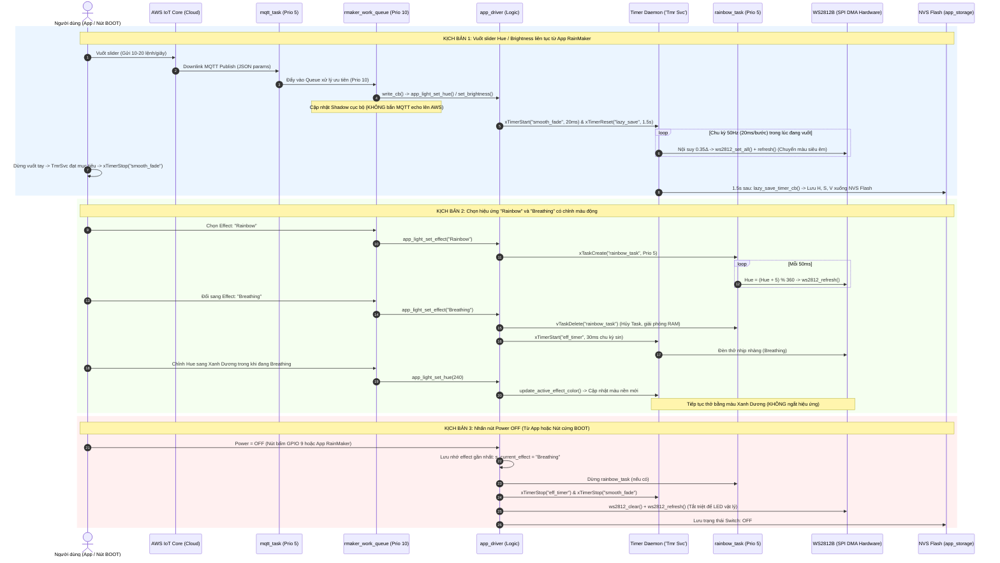

# ADR-006: Kiến Trúc Điều Khiển Từ Xa ESP RainMaker Đám Mây, Assisted Claiming & Thiết Bị Bóng (Device Shadow)

- **Trạng thái**: Đã phê duyệt (Accepted)
- **Ngày quyết định**: 2026-09-23
- **Phạm vi**: `device_firmware/5_rainmaker`, `docs/progress/9.4 Practice - Remote Control through ESP RainMaker.md`
- **Sơ đồ kiến trúc tương tác (Archify)**: [Xem sơ đồ trực quan Showcase (HTML)](./diagrams/ADR-006-esp-rainmaker-cloud-control.html)

---

## Bối Cảnh & Vấn Đề (Context & Problem Statement)

Sau khi hoàn thành tính năng điều khiển cục bộ độc lập mạng LAN/BLE ở Chương 8 theo [ADR-005](./ADR-005-local-control-https-mdns-ble.md), thiết bị đèn thông minh trong dự án PBL5 cần được nâng cấp lên khả năng **điều khiển từ xa qua Internet toàn cầu (Cloud Remote Control)** theo yêu cầu của **Mục 9.4 Practice: Remote Control through ESP RainMaker**.

Việc đưa một thiết bị IoT nhúng lên nền tảng đám mây thương mại đặt ra nhiều thách thức kiến trúc nghiêm ngặt:
1. **Bảo mật và Quản lý Chứng chỉ Thiết bị**: Các hệ thống IoT truyền thống thường yêu cầu nạp thủ công cặp khóa RSA/ECC và chứng chỉ số X.509 vào từng con chip trong quá trình sản xuất. Làm thế nào để thiết bị có thể tự đăng ký bảo mật với Cloud thông qua điện thoại của người dùng mà không cần nạp chứng chỉ trước từ nhà máy?
2. **Đồng bộ hóa Trạng thái Hai Chiều (Two-Way State Synchronization)**: Khi người dùng đổi màu đèn từ ứng dụng điện thoại hoặc khi bấm nút vật lý trên mạch, làm sao để trạng thái bóng thiết bị (Device Shadow) trên Cloud và phần cứng thật luôn phản ánh đồng nhất với độ trễ tối thiểu và không gây xung đột dữ liệu?
3. **Bảo toàn Cấu trúc Thành phần Dùng chung (Component Immutability)**: Thư mục `device_firmware/components/` (chứa driver `button`, `light_driver`, `app_storage`, `app_wifi`) là tài sản dùng chung của toàn bộ dự án qua nhiều chương. Trong ESP-IDF v6.0.2, các component cũ của Espressif (`wifi_provisioning`, `qrcode`) đã được tái cấu trúc thành các managed component mới (`network_provisioning`, `espressif__qrcode`). Làm thế nào để dự án `5_rainmaker` tương thích 100% với hệ thống build mới mà **tuyệt đối không chỉnh sửa** bất kỳ tệp nào trong `device_firmware/components/`?
4. **Giới hạn Phân vùng Flash 4MB & An toàn OTA**: Kích thước nhị phân của firmware tích hợp RainMaker, TLS, NimBLE và mDNS tăng lên gần 1.8MB, khiến phân vùng OTA mặc định (1792KB) bị đầy (>97%), có nguy cơ gây lỗi không thể cập nhật OTA hoặc crash hệ thống.

---

## 1. Quyết Định Kiến Trúc Tổng Thể

### 1.1. Kiến Trúc Đám Mây Serverless AWS IoT Core & Giao Thức MQTT TLS
Hệ thống kết nối trực tiếp với nền tảng **ESP RainMaker Cloud** trên hạ tầng AWS IoT Core:
- **Giao thức**: MQTT phiên bản 3.1.1 có mã hóa lớp bảo mật TLS 1.2/1.3 mutual authentication trên cổng 8883.
- **Mô hình Dữ liệu TSL (Thing Specification Language)**:
  - Khai báo một Node chứa thiết bị chuẩn `Light` kiểu `Lightbulb` (`ESP_RMAKER_DEVICE_LIGHT`).
  - Đăng ký 4 tham số tiêu chuẩn:
    * `power`: boolean (Bật / Tắt)
    * `brightness`: integer [0, 100] (Độ sáng)
    * `hue`: integer [0, 360] (Góc màu dải HSV)
    * `saturation`: integer [0, 100] (Độ bão hòa màu)
- **Cơ chế Downlink**: Hàm callback `write_cb()` lắng nghe các thay đổi từ topic MQTT Delta của Cloud, bóc tách giá trị và chuyển tiếp trực tiếp vào `light_driver_set_hsv()` và `light_driver_set_switch()`.

```text
+---------------------------------------------------------------------------------------------------+
|                     KIẾN TRÚC ĐIỀU KHIỂN ĐÁM MÂY HAI CHIỀU (TWO-WAY CLOUD SHADOW)                |
+-------------------------------------------------+-------------------------------------------------+
|   CLOUD DOWNLINK: LỆNH TỪ APP / CLOUD XUỐNG     |   HARDWARE UPLINK: BÁO CÁO TỪ THAO TÁC NÚT BẤM  |
+-------------------------------------------------+-------------------------------------------------+
| 1. Mobile App gửi thay đổi JSON qua Cloud       | 1. Người dùng nhấn nút Boot vật lý              |
| 2. AWS IoT Core đẩy bản tin Delta qua MQTT TLS  | 2. Ngắt GPIO kích hoạt callback nút bấm HAL     |
| 3. RainMaker Core nhận lệnh & gọi write_cb()    | 3. Driver cập nhật màu LED WS2812B tại chỗ (<1ms|
| 4. app_light_set_*() điều khiển LED WS2812B     | 4. Gọi esp_rmaker_param_update_and_report()     |
| 5. Phản hồi xác nhận trạng thái mới lên Cloud   | 5. Bản tin JSON đẩy lên Cloud cập nhật Shadow   |
+-------------------------------------------------+-------------------------------------------------+
```

### 1.2. Cơ Chế Cấp Chứng Chỉ Tự Động Assisted Claiming & Phân Vùng Bảo Mật
Thay vì nạp cứng chứng chỉ Private Key vào firmware:
- Khi khởi động lần đầu, thiết bị sinh cặp khóa mã hóa RSA2048 trên chip.
- Trong quá trình cấp phát mạng qua Bluetooth LE (NimBLE), ứng dụng di động ESP RainMaker làm trung gian chuyển tiếp yêu cầu ký chứng chỉ (CSR) lên máy chủ xác thực của Espressif.
- Cloud ký và cấp phát chứng chỉ số X.509 duy nhất cho thiết bị (`node_id`), sau đó ứng dụng di động nạp trả chứng chỉ này xuống phân vùng NVS an toàn mang tên `fctry`.
- **Cấu hình bảng phân vùng 4MB tối ưu**:
  ```csv
  # Name,   Type, SubType, Offset,   Size,  Flags
  sec_cert, 0x3F, ,        0xd000,   0x3000,
  nvs,      data, nvs,     0x10000,  0x6000,
  otadata,  data, ota,     0x16000,  0x2000,
  phy_init, data, phy,     0x18000,  0x1000,
  ota_0,    app,  ota_0,   0x20000,  1920K,
  ota_1,    app,  ota_1,   0x200000, 1920K,
  fctry,    data, nvs,     0x3e0000, 0x6000,
  ```
  * Mỗi phân vùng `ota_0` và `ota_1` được mở rộng lên **1920KB** (0x1E0000 bytes) và căn chỉnh ranh giới 64KB (offset `0x20000` và `0x200000`).
  * Đảm bảo dư thừa **9% dung lượng an toàn** (181 KB headroom) cho firmware cỡ 1.78MB, loại bỏ hoàn toàn nguy cơ tràn Flash khi nâng cấp OTA.

### 1.3. Giải Pháp Kỹ Thuật Shims Cấp Dự Án (Zero-Touch Adapter Shims)
Tuân thủ tuyệt đối quy tắc bất biến **"DO NOT MODIFY device_firmware/components/"**:
- Khởi tạo thư mục adapter tại `device_firmware/5_rainmaker/components/`:
  1. `wifi_provisioning/`: Forwarding headers (`manager.h`, `scheme_ble.h`, `scheme_softap.h`) ánh xạ toàn bộ API cũ sang component chính thức `network_provisioning` của ESP-IDF v6.0.2, đồng thời định nghĩa shim `WIFI_PROV_EVENT_HANDLER_NONE`.
  2. `qrcode/`: Chứa header cầu nối `qrcode.h` với hàm inline `qrcode_display()` gọi sang `esp_qrcode_generate()` và biên dịch trực tiếp 3 tệp nguồn của `managed_components/espressif__qrcode` (`esp_qrcode_main.c`, `esp_qrcode_wrapper.c`, `qrcodegen.c`).
- Kỹ thuật này giúp mã nguồn cũ của `app_wifi` được giữ nguyên vẹn 100%, không phát sinh bất kỳ dòng sửa đổi nào trong thư mục dùng chung.

### 1.4. Bộ Dịch Vụ Tiêu Chuẩn RainMaker Được Tích Hợp
Dự án kích hoạt toàn diện các dịch vụ hệ thống của RainMaker SDK:
- **SNTP Time Sync & Timezone**: Đồng bộ thời gian từ máy chủ NTP `pool.ntp.org` và quản lý múi giờ địa phương (`esp_rmaker_time_sync_init`, `esp_rmaker_timezone_service_enable`).
- **Offline Scheduling**: Dịch vụ hẹn giờ thông minh lưu trên Flash cục bộ; đèn tự động thực hiện các kịch bản bật/tắt theo giờ định sẵn ngay cả khi bị mất mạng Internet hoặc router cúp điện (`esp_rmaker_schedule_enable`).
- **OTA Upgrade Service**: Dịch vụ nâng cấp firmware từ xa qua HTTPS kèm cơ chế tự động rollback chống brick thiết bị (`esp_rmaker_ota_enable`).
- **System Service**: Hỗ trợ khởi động lại và khôi phục cài đặt gốc từ xa qua đám mây (`esp_rmaker_system_service_enable`).
- **Tối ưu Kênh Điều Khiển Đám Mây Trực Tiếp (Enforce Cloud MQTT)**: Vô hiệu hóa `CONFIG_ESP_RMAKER_LOCAL_CTRL_ENABLE` trên kiến trúc đơn nhân ESP32-C3 để triệt tiêu hiện tượng nghẽn socket bắt tay mật mã (crypto handshake) khi vuốt thanh trượt độ sáng và bánh xe màu tốc độ cao, đồng thời tiết kiệm 91 KB bộ nhớ Flash/RAM. Toàn bộ lệnh điều khiển đi trực tiếp qua AWS IoT Core MQTT dưới 50ms.
- **Ổn định RF và Kháng Nhiễu Wi-Fi**: Khóa băng thông 20MHz (`WIFI_BW20`), vô hiệu hóa PMF (`pmf_cfg.capable = false`), hạ TX Power xuống 12 dBm để chống sụt áp nguồn RF trên ESP32-C3.


### 1.5. Kế Thừa Phần Cứng Đa Kiến Trúc (Multi-Target Dual-Target Invariant)
Duy trì sự đồng nhất hoàn hảo với các chương trước:
- **Đầu ra ánh sáng**: Dải LED WS2812B 8 hạt trên **GPIO 4**, điều khiển bằng bộ tạo xung phần cứng **SPI2 DMA @ 3.2MHz** (`light_driver`), loại bỏ hoàn toàn hiện tượng nhấp nháy hoặc trôi màu do ngắt FreeRTOS.
- **Đầu vào nút bấm vật lý**: Nút Boot tích hợp HAL (`button`) hỗ trợ 3 cử chỉ:
  * **Nhấn 1 lần (Single Click)**: Đảo trạng thái Bật/Tắt và đẩy báo cáo `esp_rmaker_param_update_and_report`.
  * **Nhấn đúp (Double Click)**: Xoay vòng bảng màu HSV qua 6 gam màu chuẩn (Đỏ, Vàng, Xanh lá, Cyan, Xanh dương, Tím) và đồng bộ giá trị Hue lên Cloud.
  * **Nhấn giữ >3 giây (Long Press)**: Nhấp nháy LED màu đỏ và kích hoạt khôi phục cài đặt gốc (Factory Reset).
- **Ánh xạ chân phần cứng**: Tự động nhận diện bo mạch qua header:
  * `CONFIG_IDF_TARGET_ESP32S3`: Nút Boot tại **GPIO 0**.
  * `CONFIG_IDF_TARGET_ESP32C3`: Nút Boot tại **GPIO 9**.

### 1.6. Kiến Trúc Đa Nhiệm FreeRTOS & Bộ Máy Làm Mượt 50Hz (Smooth Fading & Multi-Tasking)
Nhằm mang lại trải nghiệm ánh sáng cao cấp ("chuyển động siêu mượt theo thanh trượt") và triệt tiêu xung đột đa nhiệm trên chip đơn nhân RISC-V ESP32-C3:
- **FreeRTOS Task Hierarchy**:
  - `tiT` (Priority 23) & `LwIP` (Priority 18): Đảm bảo các khung truyền Wi-Fi và mạng TCP/IP không bị gián đoạn.
  - `rmaker_work_queue` (Priority 10 - Boosted): Xử lý tức thì các tập lệnh JSON hàng đợi từ Cloud.
  - `mqtt_task` (Priority 5) & `rainbow_task` (Priority 5): Duy trì kết nối MQTT và chu kỳ quay màu 50ms.
- **Bộ máy làm mượt 50Hz (`smooth_fade_timer`)**:
  - Chạy trên `Tmr Svc` daemon ở tần số 50Hz (chu kỳ 20ms).
  - Sử dụng thuật toán nội suy làm mượt hàm mũ: $\text{Current} = \text{Current} + (\text{Target} - \text{Current}) \times 0.35$.
  - Triệt tiêu hoàn toàn độ trễ bước nhảy, giúp ánh sáng chuyển màu và bừng sáng êm dịu theo ngón tay người dùng.
- **Trì hoãn ghi Flash NVS 1.5s (`lazy_save_timer`)**:
  - Khi người dùng vuốt liên tục thanh màu, các lệnh không ghi trực tiếp vào NVS Flash để tránh nghẽn CPU và chống mòn chip nhớ.
  - Sau khi người dùng ngừng thao tác 1.5 giây, timer tự động kích hoạt một lần duy nhất để lưu cấu hình.
- **Hiệu ứng Ánh sáng Động (`Blink`, `Breathing`, `Rainbow`) & Dynamic Color Tuning**:
  - Hỗ trợ đổi màu tức thì ngay khi đang chạy hiệu ứng nhấp nháy (`Blink`) hoặc thở (`Breathing`) qua hàm `update_active_effect_color()` mà không làm ngắt hoặc văng chế độ.
  - Quản lý vòng đời `rainbow_task`: Tạo động bằng `xTaskCreate` khi chọn và tự động thu hồi tài nguyên RAM bằng `vTaskDelete` khi chuyển chế độ hoặc tắt đèn.
- **Triệt tiêu Xung đột Bật/Tắt (Power Conflict Fallback)**:
  - Tắt nguồn (`OFF`): Dừng triệt để toàn bộ task/timer hiệu ứng, dọn sạch phần cứng LED (`ws2812_clear()`), lưu trạng thái nhớ `s_current_effect`.
  - Bật nguồn (`ON`): Tự động khôi phục hiệu ứng đã cấu hình trước đó, hoặc chạy hiệu ứng Soft Fade-in nếu ở chế độ màu tĩnh (`Static`).
  - Khi đèn đang Tắt: Thao tác đổi màu trên App chỉ lưu cấu hình ngầm vào NVS, không vô tình làm sáng đèn vật lý.
- **Bảo Vệ Hạn Ngạch MQTT (MQTT Budget Protection)**:
  - Khi nhận lệnh từ Cloud/App (`ctx->src == ESP_RMAKER_REQ_SRC_CLOUD` hoặc `ESP_RMAKER_REQ_SRC_LOCAL`), thiết bị chỉ gọi `esp_rmaker_param_update()` cập nhật Node Shadow nội bộ mà không gọi `_and_report`, triệt tiêu hoàn toàn lỗi cạn kiệt hạn ngạch `Out of MQTT Budget`.



---

## 2. Hệ Quả & Đánh Giá (Consequences & Trade-offs)

### Mặt tích cực (Positive Outcomes)
1. **Trải nghiệm người dùng hoàn chỉnh**: Thiết bị đèn thông minh có thể được quản lý tập trung từ bất kỳ đâu qua app di động, hỗ trợ đầy đủ các tính năng hiện đại như hẹn giờ offline, đổi màu sắc vô cấp và điều khiển giọng nói qua Alexa/Google Home.
2. **Bảo mật chuẩn công nghiệp**: Mọi luồng giao tiếp dữ liệu đều được mã hóa bằng TLS 1.2/1.3 với chứng chỉ X.509 riêng biệt cho từng thiết bị lưu trong phân vùng `fctry`.
3. **Tính độc lập & toàn vẹn Monorepo**: Thư mục dùng chung `device_firmware/components/` được bảo vệ nguyên vẹn 100%, không bị ảnh hưởng bởi sự thay đổi phiên bản của các thư viện ngoài.
4. **Khả năng tự phục hồi & cập nhật an toàn**: Bảng phân vùng 1920KB đảm bảo đủ không gian cho 2 phân vùng chạy song song (Active / Inactive OTA) với cơ chế Rollback chống treo mạch.
5. **Hiệu năng & Độ êm tuyệt đối**: Chuyển động mượt mà 50Hz, không lag, không cạn kiệt budget MQTT, bảo vệ tuổi thọ chip Flash tối đa.

### Đánh đổi (Trade-offs & Mitigations)
- **Dung lượng Flash lớn**: Firmware chiếm ~1.78MB trên Flash 4MB. Điều này đã được khắc phục hoàn toàn bằng cách tối ưu bảng phân vùng lên 1920KB (dư 9% không gian trống) và bật cơ chế giải phóng bộ nhớ tạm TLS (`CONFIG_MBEDTLS_DYNAMIC_BUFFER=y`).
- **Phụ thuộc kết nối đám mây khi cấp phát lần đầu**: Quá trình Assisted Claiming cần điện thoại có kết nối Internet để gửi CSR lên server Espressif. Sau khi đã nhận chứng chỉ một lần, thiết bị hoạt động độc lập và có thể điều khiển qua LAN Local Control kể cả khi mất Internet.

---

## 3. Liên Kết Sơ Đồ Kiến Trúc (Architecture Visual Evidence)

Toàn bộ các luồng giao tiếp, ranh giới thành phần, cơ chế trao đổi chứng chỉ và đồng bộ bóng thiết bị được trực quan hóa chi tiết trong sơ đồ Archify tương tác độc lập:
- **Tệp sơ đồ HTML**: [`docs/decisions/diagrams/ADR-006-esp-rainmaker-cloud-control.html`](./diagrams/ADR-006-esp-rainmaker-cloud-control.html)
- **Tệp đặc tả JSON**: [`docs/decisions/diagrams/ADR-006-esp-rainmaker-cloud-control.architecture.json`](./diagrams/ADR-006-esp-rainmaker-cloud-control.architecture.json)
- **Kiểm định chất lượng Archify**: 9/9 tiêu chí đạt chuẩn Showcase Profile, 0 lỗi bố cục, 0 cảnh báo.
